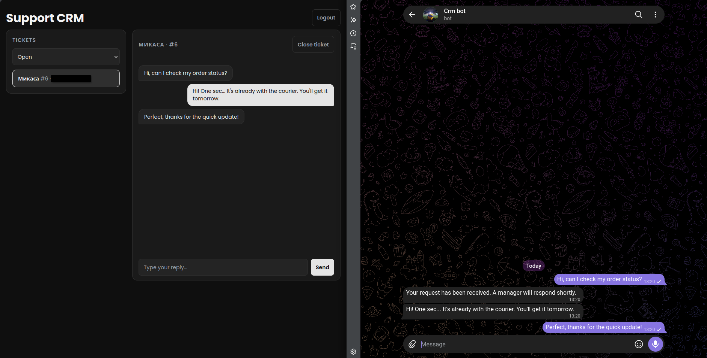
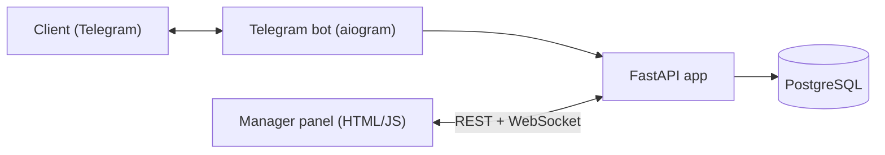

# Support CRM

A customer support system: clients write to a Telegram bot, managers answer from a real-time web panel.




## What it does

- Clients contact support through a Telegram bot. No app and no sign-up on their side.
- Every conversation is a ticket. Follow-up messages go into the open ticket; after it is closed, the next message starts a new one.
- Managers log in to a web panel, see all tickets (filter: open / closed), read the conversation, reply and close tickets.
- A reply from the panel is delivered to the client in Telegram.
- New messages and ticket changes appear in the panel instantly, without refreshing the page.
- The first manager who replies is recorded as the ticket's assignee.
- Manager accounts are created by an admin; public registration is closed.

## Architecture



## Tech stack

FastAPI (async), SQLModel / SQLAlchemy, PostgreSQL, aiogram 3, WebSockets, JWT + bcrypt, vanilla HTML/CSS/JS, Docker Compose, pytest, GitHub Actions.

## Engineering decisions

- **Reply is sent to Telegram first, saved second.** If Telegram rejects the message (for example, the client blocked the bot), the API returns an error and nothing is written to the database. The panel never shows a reply the client did not receive. A test covers this.
- **WebSocket is only a signal.** It says "ticket 5 changed"; the panel then loads the data through the normal authenticated REST endpoints. Access checks live in one place, and after a reconnect the panel simply reloads the current state from the database, so no message is lost.
- **WebSocket authentication without the token in the URL.** The token is sent as the first message and must arrive within 10 seconds. URLs end up in logs; messages do not. The socket does not hold a database connection open for its whole lifetime.
- **Client messages are treated as untrusted input.** Anyone can write to the bot, so names and texts are rendered with `textContent`, never `innerHTML`. A message containing HTML or JavaScript cannot run in a manager's browser.
- **Tickets are never deleted, only closed.** The history stays available.
- **Fast Docker rebuilds.** The Dockerfile installs dependencies before copying the source code, so after a code change only the last layer is rebuilt (seconds instead of minutes). `.env` is excluded from the image; secrets are passed at runtime.
- **Isolated tests.** Tests run against a separate PostgreSQL database that is recreated before every test, with a guard that refuses to run unless the database name ends with `_test`. The Telegram API is mocked, so tests are fast and never message real people.
- **CI on every push.** GitHub Actions runs the test suite against a real PostgreSQL service container and builds the Docker image only if the tests pass.

## Run it

```bash
cp .env.example .env          # fill in the values
docker compose up --build -d
docker compose exec app python -m app.create_manager you@example.com "Your Name"
```

Open http://localhost:8000/login

## Tests

```bash
pip install -r requirements-dev.txt
pytest
```

Requires a `support_test` database (see `TEST_DATABASE_URL` in `.env.example`).